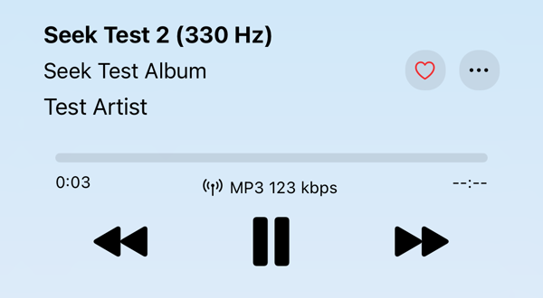
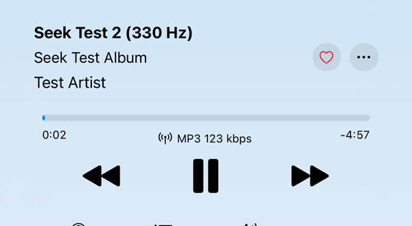

# Amperfy: duration and seeking on transcoded streams

This repository reproduces an Amperfy bug and tests the fix in [PR #859](https://github.com/BLeeEZ/amperfy/pull/859). The bug report is [#725](https://github.com/BLeeEZ/amperfy/issues/725). [#514](https://github.com/BLeeEZ/amperfy/issues/514) and problem 3 of [#672](https://github.com/BLeeEZ/amperfy/issues/672) describe the same bug.

The test makes the bug occur on every play. It does not need a slow network, a cellular connection, or a real device.

Results: [results/2026-10-27-simulator.md](results/2026-10-27-simulator.md)

## Recordings

The same song, streamed as a live MP3 transcode, a few seconds after the start:

| `master` | PR #859 |
|---|---|
|  |  |

Screen recordings from the iOS Simulator:

| Recording | Build | What it shows |
|---|---|---|
| [master-2-seek-ignored.mp4](recordings/master-2-seek-ignored.mp4) | `master` | The duration is `--:--`. The scrubber shows `0:00` on both sides. After each seek, the counter continues from the old position. |
| [master-3-seek-and-pause-fail.mp4](recordings/master-3-seek-and-pause-fail.mp4) | `master` | Seeks while the song plays and while it is paused. The position does not change. |
| [master-4-works-after-amperfy-download.mp4](recordings/master-4-works-after-amperfy-download.mp4) | `master` | The first play streams (antenna icon), and the duration is `--:--`. After a replay from the downloaded copy (download icon), the duration and seeking work. |
| [pr-859-duration-and-seeking.mp4](recordings/pr-859-duration-and-seeking.mp4) | PR #859 | The first play streams (antenna icon). The remaining time shows at once. Seeks forward, seeks back, fast seeks, and seeks while paused all work. |

## The bug

Amperfy streams a song that Navidrome transcodes, for example to MP3 at 256 kbps. The player shows `--:--` as the duration. Seeking does not work. After many seeks, the playback stops, but the app continues to show "playing". If you do not seek, the song plays from start to end.

## Cause

Navidrome transcodes the song with ffmpeg while it sends the song. The size of the result is not known before the transcode is complete. Thus the response has no `Content-Length` header and has `Accept-Ranges: none`.

AudioStreaming, the player library in Amperfy, calculates the duration from the byte length. It seeks with HTTP range requests. A live transcode supports neither.

On a second play, the song usually comes from a cache. This is the transcoding cache of Navidrome, or the copy that Amperfy downloads while it plays the song. A cached file has a size and supports range requests. Thus the bug occurs only on the first play of a song, and it looks random.

PR #859 makes two changes:

- If the player has no duration, Amperfy shows the duration from the song metadata.
- On a live transcode, a seek starts a new stream request with the Subsonic `timeOffset` parameter. Amperfy does this only if the server announces the OpenSubsonic `transcodeOffset` extension.

## How the test makes the bug occur every time

The test server is Navidrome 0.64.2 with the transcoding cache off (`ND_TRANSCODINGCACHESIZE=0`). Thus every transcoded play is a live transcode.

## Contents

| Path | Purpose |
|---|---|
| `compose.yaml` | Navidrome test server, transcoding cache off, debug log |
| `scripts/make-test-tracks.sh` | Makes three 5-minute FLAC test tracks with the ffmpeg in the Navidrome image |
| `scripts/check-headers.sh` | Tests the server side of the bug with curl, without Amperfy |
| `scripts/build-sims.sh` | Builds Amperfy `master` and the PR, and installs each build in its own simulator |
| `scripts/seek-log.py` | Lists the stream requests from the server log, without credentials |
| `results/` | Test results |
| `recordings/` | Screen recordings and images of the tests |

## Requirements

- macOS with Xcode and an iOS Simulator runtime
- Docker (OrbStack or Docker Desktop)
- git, curl, and python3

## Procedure

1. Make the test tracks:

   ```sh
   ./scripts/make-test-tracks.sh
   ```

2. Start the server:

   ```sh
   docker compose up -d
   ```

3. Do the server test. Each line must show `PASS`:

   ```sh
   ./scripts/check-headers.sh
   ```

4. Build and install both Amperfy builds:

   ```sh
   ./scripts/build-sims.sh
   ```

   The script makes two simulators, "Amperfy master" and "Amperfy PR 859". The default device is an iPhone 17 Pro on the newest iOS runtime. To use a different device, set `DEVICE_TYPE`. To test a different PR, set `PR`.

5. Open both simulators from Xcode.
6. In each simulator, log in to `http://127.0.0.1:4533` with the user `admin` and the password `seektest`.
7. In each simulator, open Settings > Player, Stream & Scrobble. Set the WiFi streaming format to MP3 and the bitrate limit to 256 kbps.
8. In each simulator, play "Seek Test 1". Do the tests in the table below. Use the time counters, because the tracks are only a beep each second.

   Note: Amperfy can download a song while it plays the song. A replay then uses the downloaded copy, and the bug does not occur. The player shows a download icon instead of an antenna icon for a downloaded copy.

   If the player shows the download icon, use a different track, or remove the downloaded copy in Amperfy.
9. Show the stream requests from the server log:

   ```sh
   ./scripts/seek-log.py
   ```

   In the PR build, each seek shows as a request with a `timeOffset` value. The `bytes` column must be almost equal to the `expected` column.

## Tests

| Test | Result before the fix | Result with the fix |
|---|---|---|
| The duration shows on the first play | `--:--` | The remaining time, for example `-4:57` |
| Seek forward to 2:00 | No change | The counter goes to 2:00, and the playback continues |
| Seek back to 0:30 | No change | The counter goes to 0:30, and the playback continues |
| Do many seeks fast | The playback stops | The playback continues |
| Pause, then seek | No change | The song stays paused at the new position |
| Seek to 4:50 | No change | At 5:00, "Seek Test 2" starts |
| Use the lock screen scrubber | No change | The lock screen and the player go to the new position |

## Clean up

```sh
docker compose down
rm -rf music data work
xcrun simctl delete "Amperfy master" "Amperfy PR 859"
```

## Note on the password

The server is for local tests only. `seektest` is a fixed test password. To use a different password, set `ND_ADMIN_PASSWORD` for `docker compose` and for `check-headers.sh`.
